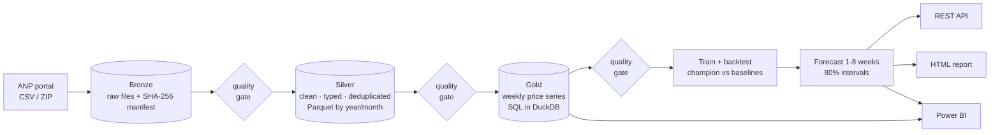

# 🛢️ Data Lake & Price Forecasting Platform


An end-to-end data platform for Brazil's **ANP fuel price survey**: a **medallion data lake** (bronze → silver → gold) on Parquet and DuckDB, an **orchestrated pipeline** with data-quality gates, a **backtested forecasting model** that has to prove it beats "no change", a **REST API**, and Power BI queries.

It processes the real ANP files (**3.25 million rows**, 2023-2026) in under two minutes and forecasts gasoline, ethanol and diesel prices 1-8 weeks ahead for every state.



## What is in the box

| Layer | What it does |
|:--|:--|
| **Sources** | Resolves ANP files across *three* naming schemes and the semester ZIP archives; detects months ANP never published |
| **Bronze** | Raw files byte for byte, with URL, SHA-256, size and fetch time. Idempotent, resumable, integrity-checked |
| **Silver** | Cleaning in SQL: types, `dd/mm/yyyy` and decimal commas, CNPJ repair, rejects counted by reason, duplicates across overlapping sources removed. Rebuilt from bronze on every run |
| **Gold** | Weekly average / median / dispersion per state and product (plus a national roll-up) with SQL window logic |
| **Quality** | 16 checks between layers: `error` stops the pipeline, `warn` is recorded and the run continues |
| **Orchestration** | A small DAG runner: dependency order, retries with backoff, failure propagation, one JSON log per run |
| **Modelling** | Leak-free features, forward-chaining backtest, 7 candidate models, a bootstrap confidence interval on the result |
| **Serving** | FastAPI over the lake, with OpenAPI docs; reports which model run and data produced each answer |

## Verified on the real ANP data

| | |
|:--|:--|
| Raw files | **79** (492 MB) covering Jan 2023 – Sep 2026, downloaded in 87 s |
| Rows read | **3,251,859** |
| Rejected | 1,477 (**0.05%**, all `missing_cnpj`) |
| Duplicates removed | 86,003 = 77,875 (June 2026 monthly file vs the semester archive) + 8,108 (last-4-weeks vs August) + 20 inside files |
| Silver | **3,164,379** rows · 14,171 stations · 27 states · 6 products |
| Time (bronze cached) | silver 17 s · gold 1.5 s · **whole pipeline incl. training 1 min 42 s** |
| Reproducible | Re-running gives the same champion and the same scores |

**A real gap, handled.** ANP published no monthly file for **July 2026** (and no semester archive for H2). The source resolver records it, the quality gate raises a warning naming the exact missing weeks (`2026-07-06..2026-07-27`, 4 weeks, every product), and the model bridges the hole by interpolation *only as an input*: bridged weeks are flagged and are never used as ground truth when scoring.

## Does the model work? An honest answer

Every forecast is scored against the **naive baseline** ("next week equals this week"), out of sample, with a rolling-origin backtest: 12 folds, 8 horizons, 80 series, origins 2026-02-16 to 2026-09-14. A model is only promoted if it wins.

| Model | MAE (R$) | MAPE | vs naive |
|:--|--:|--:|--:|
| **blend** (ridge + gradient boosting) | **0.1327** | 2.14% | **+7.1%** |
| gbm | 0.1378 | 2.22% | +4.0% |
| ridge | 0.1393 | 2.25% | +2.9% |
| naive | 0.1419 | 2.29% | 0.0% |
| drift | 0.1566 | 2.53% | -10.0% |
| ma4 / ma8 | 0.1776 / 0.2170 | 2.85% / 3.47% | -32% / -72% |

- **The edge is real but modest**: +7.1% lower error, with a **95% confidence interval of +1.1% to +11.0%**. That interval comes from a *week-level* bootstrap (states in the same week share shocks, so resampling rows would be far too optimistic). It excludes zero, but only just.
- **It is largest near-term**: about 10% at 1 week, about 5% at 8 weeks. Typical error goes from R$ 0.04 (1 week) to R$ 0.24 (8 weeks).
- **The 80% intervals are calibrated**: quantiles learned on early folds covered **85%** of 3,702 forecasts on later, unseen folds.
- Smoothing baselines (`ma4`, `ma8`) are *worse* than naive: the last observation carries real information.

### What I would not claim

- **The gain is not robust to how the data is sampled.** On the bundled 30-stations-per-state random sample the blend also wins (+6%), but on other samples I tried (60 per state; the best-covered stations) the naive baseline won, so the pipeline correctly kept it as champion. My hypothesis is that part of the edge comes from correcting week-to-week *sampling noise* (ANP surveys different stations each week), not from predicting real price moves. The sample results are consistent with that, but they are not proof.
- **The demo result is not evidence of model quality.** It exists to show the machinery, including the guardrail that refuses to promote a model that has not earned it (tested on synthetic data with no structure to learn).
- **Interval calibration needs enough backtest weeks.** With few folds it can be off (on synthetic runs with 6-12 folds, coverage ranged from 44% to 72% for a nominal 80%).
- **No price shocks.** Fuel prices jump with policy and refinery decisions; a model trained on past weekly data cannot see those coming.

## Quick start

```bash
git clone https://github.com/horaguimaraes/datalake-forecasting-platform.git
cd datalake-forecasting-platform
python -m venv .venv && source .venv/bin/activate      # Windows: .venv\Scripts\activate
pip install -e ".[dev]"

fuellake demo            # offline, ~40 s: the whole pipeline on the bundled sample
fuellake serve --root data/demo_lake      # API on http://localhost:8000/docs
```

The bundled sample is a seeded random sample of 810 real stations (30 per state), as raw ANP lines (3.9 MB). Open `data/demo_lake/reports/forecast_report.html` for the report.

### Run it on the real data

```bash
fuellake run                          # downloads ~500 MB from ANP the first time; cached afterwards
fuellake run --start 2024-01          # a shorter history is faster
fuellake run --only train,forecast,report      # re-run just the modelling steps
fuellake run --from silver            # a cleaning rule changed: rebuild silver and everything after
fuellake status                       # what is in the lake
fuellake sql "SELECT product, round(avg(avg_price),2) FROM weekly_prices WHERE state='BR' GROUP BY 1"
fuellake graph                        # the pipeline DAG as Mermaid
```

## The lake

```
data/lake/
├── bronze/   anp/<source>/<file as published>      + _manifest.json (url, sha256, bytes, fetched_at, covers)
├── silver/   prices/year=2025/month=3/*.parquet    + _metrics.json, _rejects.parquet
├── gold/     weekly_prices.parquet · stations.parquet
├── models/   <run_id>/{artifact.joblib, metrics.json, backtest_predictions.parquet} + latest.json
├── forecasts/latest.parquet
├── reports/  forecast_report.html · quality_report.json
└── runs/     <run_id>.json          (status, attempts, duration and output of every task)
```

Query any layer directly with DuckDB (`fuellake sql ...`) or from Power BI, pandas or Spark; it is plain Parquet.

## REST API

| Endpoint | Returns |
|:--|:--|
| `GET /v1/forecast?product=&state=` | 1-8 week forecast with an 80% interval and the naive baseline, plus the model run that made it |
| `GET /v1/forecast/movers?horizon=&direction=` | States expected to move most |
| `GET /v1/history?product=&state=&weeks=` | Weekly average and median price, stations and observations |
| `GET /v1/models` | The champion, the full ranking, the skill confidence interval and interval coverage |
| `GET /v1/quality` · `/v1/lineage` | Every check and its result · which raw files (with SHA-256) produced the data |
| `GET /v1/series` · `/health` | What can be forecast · layer readiness |

`state` is a UF (`RJ`) or `BR` for national. Interactive docs at `/docs`. Set `API_KEY` to require an `x-api-key` header (`/health` stays open). New pipeline runs are picked up without restarting.

## Design decisions

- **Silver is a pure function of bronze.** It is rebuilt from scratch each run, so it can never drift from the raw files, and fixing a cleaning rule is just re-running a step.
- **Bronze never interprets.** Files are stored exactly as published, checksummed on write and verified by the quality gate, so every number downstream is traceable to bytes.
- **The source resolver assumes nothing.** ANP changed its URL scheme over the years and skips months. It tries each known shape, falls back to the semester ZIP, and records real gaps instead of failing or silently ignoring them.
- **Quality gates sit between layers, with two severities.** Bad data must not reach the model (errors stop the run), but a known upstream gap should not block a weekly refresh (warnings are recorded).
- **Forecast returns, not levels.** Predicting the log return from the origin week lets one model serve every product and state, and makes "beat no change" the natural yardstick.
- **Leakage is prevented in one place and tested there.** `split_fold` decides what a model may see (`max(train.target_week) <= cutoff < min(test.week_start)`); a separate test rewrites every future price and asserts no feature at or before the cutoff changes.
- **Baselines are first-class.** `naive` is mandatory, and the champion is whichever model has the lowest error, which can be the baseline.
- **Uncertainty is reported, not implied.** Intervals come from empirical backtest residuals, and their coverage is measured on folds the quantiles never saw.

## Project layout

```
src/fuellake/
├── sources.py  bronze.py  silver.py  gold.py  quality.py     data layers
├── orchestrator.py  pipeline.py  cli.py                       DAG, tasks, commands
├── ml/  dataset.py  features.py  models.py  backtest.py  train.py  forecast.py
├── api.py  report.py
└── sql/  weekly_prices.sql  stations.sql
tests/       141 tests: parsing and cleaning, source resolution (mocked HTTP), orchestrator, leakage, backtest maths, API, CLI
scripts/     make_sample.py  (rebuilds data/sample from a real bronze layer)
powerbi/     Power Query for Parquet and API sources
.github/     CI (lint, tests on 3.11 and 3.12, offline demo + API smoke test) and a weekly refresh workflow
```

## Tests

```bash
pytest                    # 141 tests, ~45 s
ruff check src tests scripts
```

Tests run on **synthetic ANP files with a known price process**, so they check real effects rather than just "does not crash": a model must beat naive when there is sampling noise to learn (+16% in the fixture, confidence interval above zero), and the pipeline must *refuse* to promote a learned model when there is none. Downloads are tested against an in-memory fake of the ANP portal (404s, 5xx retries, empty bodies, interrupted runs).

## Limitations and what is not verified

- **Docker image**, the **weekly refresh workflow** and the **Power BI queries** are written but have not been run (Docker is not installed on my machine; the workflow needs a first manual run; no `.pbix` is committed). CI covers lint, tests and the offline demo.
- ANP publishes weekly averages from a **sample of stations**, so state-level series are noisy, and small states are excluded from modelling (fewer than 10 stations per week).
- The forecast is univariate-plus-cross-section. It knows nothing about crude oil, the exchange rate, taxes or refinery pricing decisions.
- Older semester archives (before 2023) were not exercised; the resolver supports them but they were not part of this run.
- Pipelines run sequentially in one process. That is right for 3 million rows; a larger lake would move the same tasks onto Airflow or Prefect (each task is already a plain function with declared dependencies).

## Data

[ANP, Série histórica do levantamento de preços de combustíveis](https://www.gov.br/anp/pt-br/centrais-de-conteudo/dados-abertos/serie-historica-de-precos-de-combustiveis), published under the Petroleum Law (Lei nº 9.478/1997, art. 8º). The bundled sample is a subset of that public data. This project is not affiliated with ANP.

## License

MIT © Lucas Hora (code only; the data belongs to ANP).
